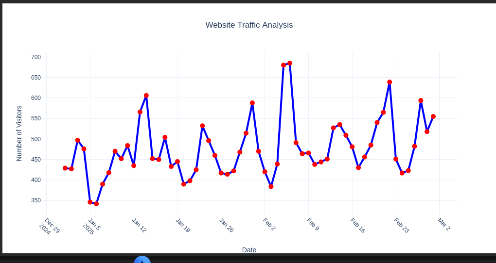

# Website Traffic Analysis Using Plotly

## Project Description
This project analyzes website traffic using Python, Pandas and Plotly. It visualizes website visitors over time using an interactive line graph.

## Technologies Used
- Python
- Pandas
- Plotly
- Google Colab

## Dataset
The dataset contains:
- Date
- Number of Website Visitors
- Page Views
- Average Session Duration
- Bounce Rate

## Output

## Features
- Interactive line chart
- Date-wise website visitor analysis
- Hover information
- Data visualization
- HTML graph export
